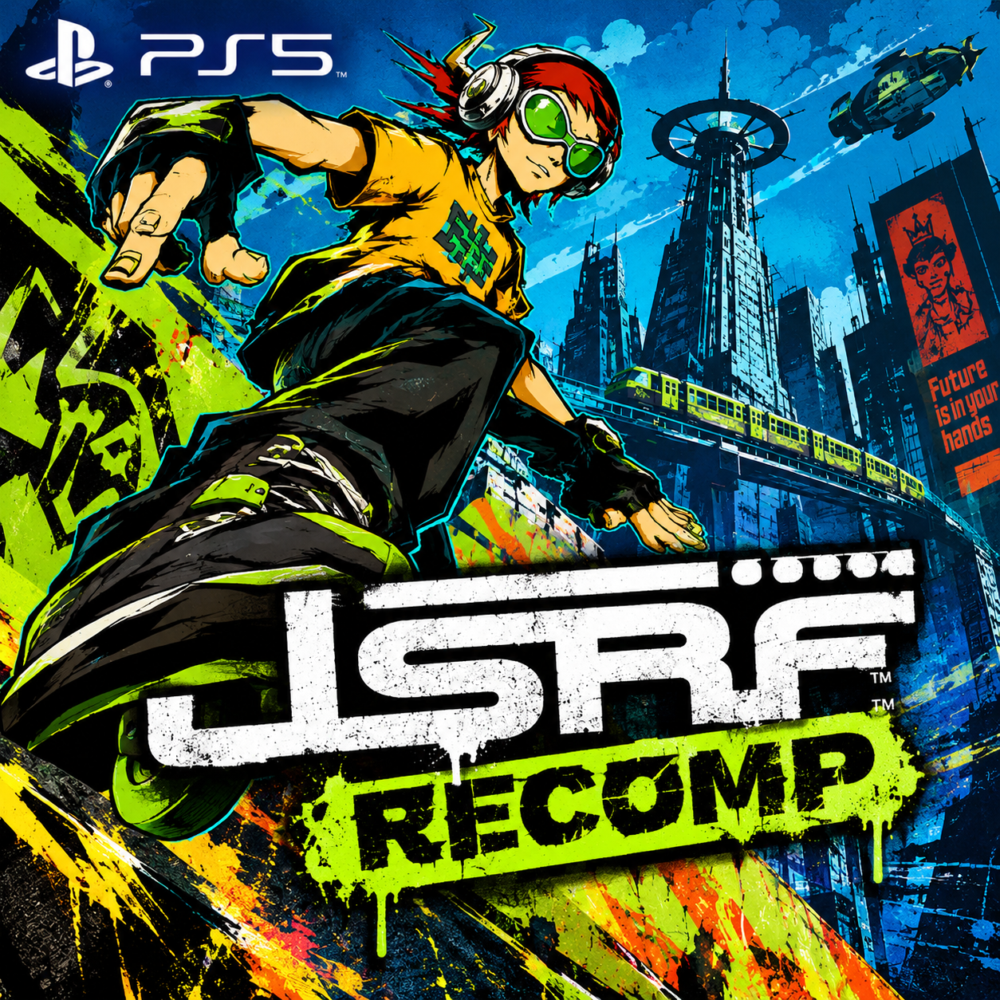

# JSRF Unleashed for the PlayStation 5

A port of [JSRF Unleashed](https://github.com/JuMatt/JetSetRadioFuture-Unleashed) (0.5.9, commit `414b103`) to
native PS5 homebrew. JSRF Unleashed is Jet Set Radio Future, statically recompiled from the Xbox executable into C.
On the PS5 it runs as an installed title (`PPSA69429`) and draws through a Vulkan renderer on
[Mihawk's RADV port](https://github.com/mihawk-99/PS5_Vulkan).

You need your own copy of the game. This repository holds no game data and no game code: the C code is generated
on your machine from your own `default.xbe`, and the title reads the rest from your disc image.

## Status

Work in progress. Tested on one console (ShadowMountPlus):

- The start menu, the disc import, the game's menus and play with sound and the DualSense
- Busy stretches at 58 to 60 fps at render scale 2, output at 3840x2160

Not tested on a console yet: the latest changes in this repository. They are a faster lookup of each thread's
register block, a fix for a hang at the first boss, and a shader cache on disk.

## Installing

There is no release yet. With a build of your own (see below):

1. Copy the `pkg-vk/PPSA69429` folder to `/data/homebrew/` on the console (ShadowMountPlus installs it).
2. Put your disc image of **Jet Set Radio Future (USA)**, a `.iso` file, in `/data/homebrew/PPSA69429/dump/`.
3. Start the title. The first start checks the image and unpacks it into the title folder's `game/` folder. This
   happens once and takes several minutes. After that you can remove the disc image.

Before the game starts, a short menu shows the render scale and widescreen. It counts down five seconds and starts
with the last choices. Press X to change them.

## Building

The build runs on Linux (tested on WSL2). It is not turnkey yet: it uses the RADV setup of
[rush2-ps5](https://github.com/Marice/rush2-ps5) from a checkout next to this one.

You need:

- A checkout of rush2-ps5 at `../rush2-ps5`, with Mihawk's RADV port in `radv/mihawk-vulkan-review` and its Mesa
  headers in `radv/PS5_Mesa`, built as described there, and its Docker build image `rush2-ps5-build`
- [glslang](https://github.com/KhronosGroup/glslang) 16.2.0: the source in `.deps/glslang`, built for the PS5 with
  the SDK's `prospero-clang18` into `build-vk/glslang` (Release; `ENABLE_HLSL`, `ENABLE_OPT`, `ENABLE_RTTI`,
  `ENABLE_EXCEPTIONS` and `ENABLE_GLSLANG_BINARIES` off)
- Python 3.10 or later for upstream's code generator, and CMake

Then:

1. `tools/setup-source.sh` checks out JSRF Unleashed at the pinned commit into `src-upstream/` and applies
   `patches/jsrf.patch`.
2. Generate the game's C code in `src-upstream/`, as upstream's README describes under building from source: put
   your `default.xbe` in `src-upstream/game_files/` and run its tools into `port/recomp/gen`.
3. `./build-vk.sh` builds the title into `pkg-vk/PPSA69429`. `tools/setup-pacbrew.sh` fetches the PacBrew ports
   (checked by hash) on the first run. A full build compiles over a million lines of generated C. On a machine with
   little memory, limit the parallel compiles, for example `JOBS=4 ./build-vk.sh`.

To change upstream's code, edit it in `src-upstream/` and save the change with `tools/save-patch.sh`. The patch is
the source of truth: `tools/setup-source.sh` refuses to overwrite changes that are not saved in it.

## Layout

| Path | What it holds |
| --- | --- |
| `ps5/` | The PS5 layer: start menu, disc import, status screen, POSIX gaps, the Vulkan build's CMake and link scripts |
| `patches/jsrf.patch` | The changes to JSRF Unleashed, including the Vulkan renderer `src/nv2a_vk/nv2a_vk.c` |
| `tools/` | Source and dependency setup |
| `sce_sys/`, `art/` | The title's parameters, icon and artwork |

Comments in the code refer to numbered decisions (D1, D2, ...). These are from the project's working notes, which
are not in this repository.

## Credits

- [JSRF Unleashed](https://github.com/JuMatt/JetSetRadioFuture-Unleashed) and its contributors, the recompilation
  this port builds on
- [Mihawk's RADV port](https://github.com/mihawk-99/PS5_Vulkan) for Vulkan on the PS5
- [ps5-payload-dev](https://github.com/ps5-payload-dev) for the payload SDK and the PacBrew ports
- [glslang](https://github.com/KhronosGroup/glslang) for the shader compiler

Jet Set Radio Future is a trademark of SEGA. This project is not affiliated with or endorsed by SEGA.

## License

MIT, see [LICENSE](LICENSE). JSRF Unleashed is MIT licensed too; the changes in `patches/jsrf.patch` fall under its
license.
